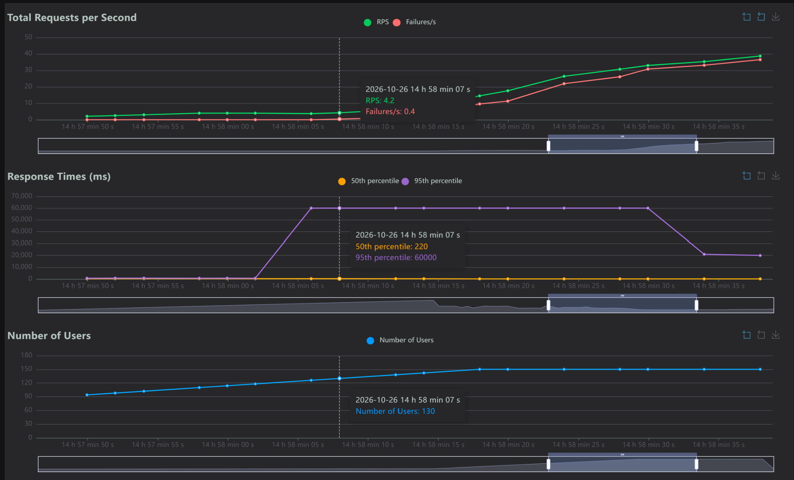
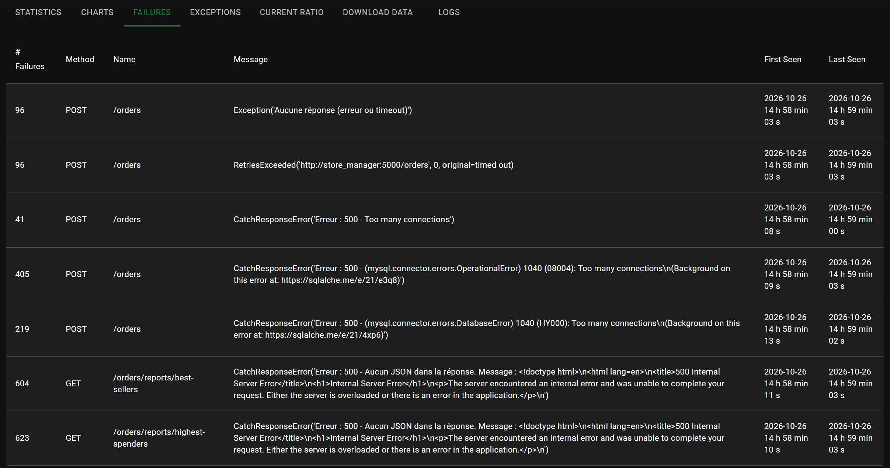
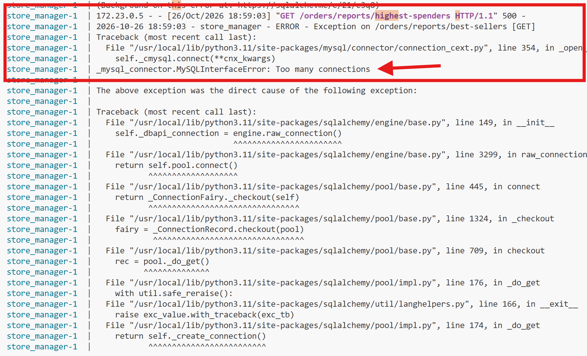
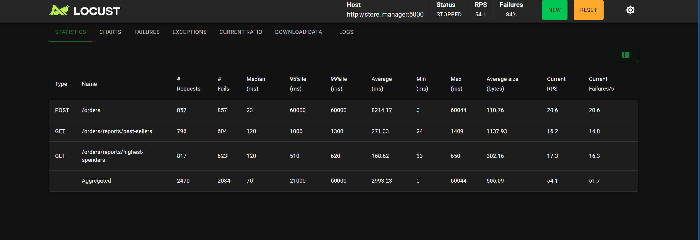
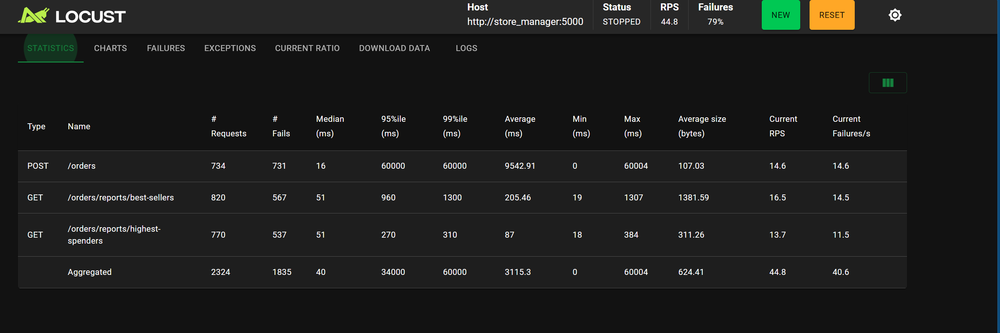
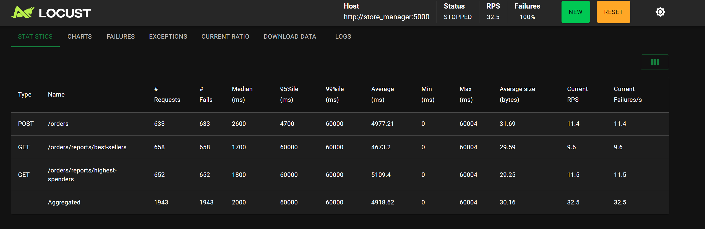

💡 Question 1 : Combien d'utilisateurs faut-il pour que le Store Manager commence à échouer dans votre environnement de test ? Pour répondre à cette question, comparez la ligne Failures et la ligne Users dans les graphiques.

On observe dans locust que des `failures` commencent à survenir lorsque le nombre d'utilisateurs atteint 130.
En effet, à ce stade, nous observons 0.4 `failures` par seconde.   
Graphiques dans locust avec un zoom sur le moment des premières `failures`:

 

---

 

💡 Question 2 : Sur l'onglet Statistics, comparez la différence entre les requêtes et les échecs pour tous les endpoints. Combien d'entre eux échouent plus de 50 % du temps ?

Durant ces tests de charge, les 3 endpoints (POST /orders, GET /orders/reports/best-sellers et GET /orders/reports/highest-spenders) échouent plus de 50% du temps. en effet:
| Endpoint | Requêtes | Échecs | Taux d’échec |
|---|---:|---:|---:|
| `POST /orders` | 857 | 857 | 100 % |
| `GET /orders/reports/best-sellers` | 796 | 604 | 75,88 % |
| `GET /orders/reports/highest-spenders` | 817 | 623 | 76,25 % |
 

---

 
💡 Question 3 : Affichez quelques exemples des messages d'erreur affichés dans l'onglet Failures. Ces messages indiquent une défaillance dans quelle(s) partie(s) du Store Manager ? Par exemple, est-ce que le problème vient du service Python / MySQL / Redis / autre ?

on peut observer dans l'onglet `failures` plusieurs échecs. Par exemple, pour POST /orders, on apercoit `CatchResponseError('Erreur : 500 - (mysql.connector.errors.OperationalError) 1040 (08004): Too many connections\n(Background on this error at: https://sqlalche.me/e/21/e3q8)')`. Cette erreur indique une défaillance dans la partie MySQL du store manager et signifie que le nombre de connection maximal à celui-ci est atteint.

De plus, on apercoit des erreurs internes au serveur pour les endpoints de best-sellers et highest-spenders. Étant donné que
locust ne s'étend pas plus dans la description de la provenance de l'erreur, nous sommes allé analyser les journaux avec la commande `docker compose logs --tail=1000 store_manager` et nous avons pu constater qu'encore une fois, c'est causé par la limite de connexions atteinte au niveau de MySQL.

 

---

 

💡 Question 4 : Sur l'onglet Statistics, comparez les résultats actuels avec les résultats du test de charge précédent. Est-ce que vous voyez quelques différences dans les métriques pour l'endpoint POST /orders ?
 

| Métrique pour `POST /orders` | Avant optimisation | Après optimisation | Variation après optimisation |
| ---------------------------- | -----------------: | -----------------: | ---------------------------- |
| Nombre total de requêtes     |                857 |                734 | −123 requêtes                |
| Nombre d’échecs              |                857 |                731 | −126 échecs                  |
| Nombre de réussites          |                  0 |                  3 | +3 réussites                 |
| Taux d’échec                 |              100 % |            99,59 % | −0,41 point de pourcentage   |
| Temps de réponse médian      |              23 ms |              16 ms | −30,4 %                      |
| Temps de réponse moyen       |        8 214,17 ms |        9 542,91 ms | +16,2 %                      |
| 95e percentile               |          60 000 ms |          60 000 ms | Aucun changement             |
| 99e percentile               |          60 000 ms |          60 000 ms | Aucun changement             |
| Temps de réponse maximal     |          60 044 ms |          60 004 ms | −40 ms                       |

On peut apercevoir que le temps de réponse médian diminue d’environ 30,4 %, mais le temps de réponse moyen augmente d’environ 16,2 %. Le taux d’échec reste très élevé, malgré trois requêtes réussies après l’optimisation.

Ces résultats ne permettent donc pas de conclure à une amélioration globale des performances de création de commandes. La suppression du problème N+1 réduit bien le nombre de requêtes de lecture des produits, mais un autre facteur limitant persiste : la saturation des connexions MySQL, indiquée par les erreurs Too many connections.

 

---

 

💡 Question 5 : Si nous avions plus d'articles dans notre base de données (par exemple, 1 million), ou simplement plus d'articles par commande en moyenne, le temps de réponse de l'endpoint POST /orders augmenterait-il, diminuerait-il ou resterait-il identique ?

Si la base de données contient davantage d’articles, par exemple un million, le temps de réponse pourrait augmenter, mais pas nécessairement de manière importante ni proportionnelle au nombre de produits. La recherche utilise les identifiants des produits, normalement indexés par la clé primaire. Elle peut donc rester efficace même avec une table plus volumineuse. Les performances dépendront notamment des index, de la mémoire disponible et des accès disque.
 
Si chaque commande contient davantage d’articles, le temps de réponse aurait tendance à augmenter. Même après l’optimisation, l’application doit récupérer davantage de produits, traiter leurs prix et leurs quantités, puis enregistrer davantage de lignes de commande et effectuer les opérations de stock correspondantes.
 

---

 

Activité 7
résultat avant optimisation

---

💡 Question 6 : Sur l'onglet Statistics, comparez les résultats actuels avec les résultats du test de charge précédent. Est-ce que vous voyez quelques différences significatives dans les métriques pour les endpoints POST /orders, GET /orders/reports/highest-spenders et GET /orders/reports/best-sellers ? Dans quelle mesure la performance s'est-elle améliorée ou détériorée (par exemple, en pourcentage) ?
 
 
La mise en cache des rapports complets dans Redis améliore fortement les performances des deux endpoints de lecture. Cependant, elle n’apporte pas d’amélioration significative à la création de commandes.

| Endpoint                               | Temps moyen avant | Temps moyen après | Variation du temps moyen | Taux d’échec avant | Taux d’échec après |
| -------------------------------------- | ----------------: | ----------------: | -----------------------: | -----------------: | -----------------: |
| `POST /orders`                         |       4 977,21 ms |       9 377,97 ms |                  +88,4 % |              100 % |            99,74 % |
| `GET /orders/reports/best-sellers`     |       4 673,20 ms |          78,51 ms |                 −98,32 % |              100 % |                0 % |
| `GET /orders/reports/highest-spenders` |       5 109,40 ms |          78,75 ms |                 −98,46 % |              100 % |             0,39 % |

 
 

💡 Question 7 : La génération de rapports repose désormais entièrement sur des requêtes adressées à Redis, ce qui réduit la charge pesant sur MySQL. Cependant, le point de terminaison POST /orders reste à la traîne par rapport aux autres en termes de performances dans notre scénario de test. Alors, qu'est-ce qui limite les performances de l'endpoint POST /orders ?

Le principal facteur observé qui limite les performances de la création de commande est la saturation du nombre de connexions simultanées à MySQL. L'onglet `Failures` indique encore `Too many connections` étant donné que la création d'une commande nécéssite quand même l'utilisation de MySQL malgré l'utilisation de redis pour les rapports.
